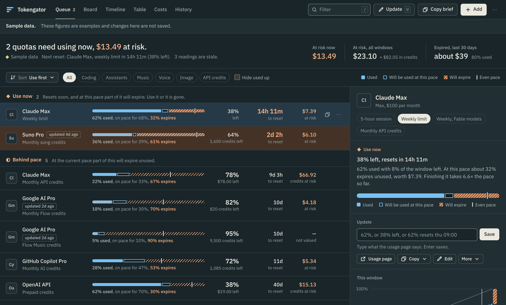
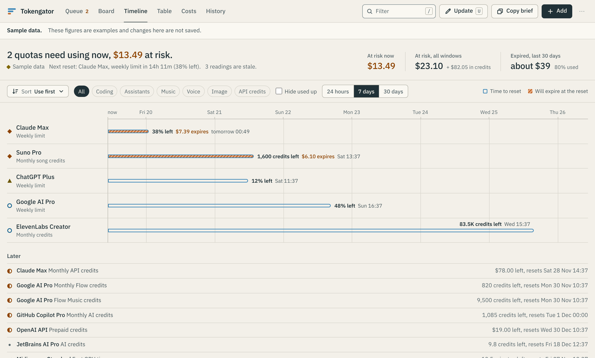

# Tokengator

AI subscriptions are sold as quota that expires. A 5-hour session, a weekly cap, a monthly pile of
credits: whatever is left when the window resets is gone, and you paid for it either way.

Tokengator keeps every one of those clocks on one screen and answers a single question:
**what should I use first so nothing goes to waste?**

- A local dashboard, sorted by what is about to expire, with the money that is at risk.
- Reminders that reach you when the dashboard is closed: on this computer, on your phone, in your
  calendar, and in your agent's status line.
- An MCP server, so agents can ask which subscription to spend and report fresh numbers.
- A command line and a status line integration.
- A skill that teaches agents when to check and when to report.



It runs on your machine, on Windows, macOS and Linux. No account, no telemetry, nothing leaves
loopback unless you switch on a collector that calls a provider's API with your own key.

## Quick start

```bash
cd tokengator
npm ci
npm run build
npm start            # http://127.0.0.1:4777
npm run demo         # the same, on built-in sample data
```

Open the dashboard, press **A** to add a subscription from the catalog, then type what the provider's
usage page says:

```
claude weekly 62% resets thu 09:00
suno 1200 left resets in 9d
copilot 412/1500
```

That is the whole manual loop. A bare amount means *used*; the preview spells out both used and
left before anything is saved.

## What it shows

Every quota is drawn the same way:

```
used ████████████▓▓▓▓▓▓▒▒▒▒▒▒▒▒▒▒▒▒ expires
                         │ even pace
```

Solid blue is what you have used, dim blue is what you will use at your current pace, hatched
orange is what will expire unused, and the tick is where an even pace would be right now.

Each quota gets one state:

| State | Meaning |
| --- | --- |
| **Use now** | Resets soon with at least 10% left. Use it or it is gone. |
| **Behind pace** | At the current pace 15% or more will expire. |
| **Running hot** | It will run out well before the reset. Ration it. |
| **On pace** | On track to be used up around the reset. |
| **New window** | Just reset; too early to forecast. |
| **Used up** | Fully used. Nothing is wasted. |

Six views over the same data, switched with the number keys:

1. **Queue**: ranked by what needs using first, with an inspector.
2. **Board**: one card per subscription with all its meters.
3. **Timeline**: every reset on one time axis (24 hours, 7 days, 30 days).
4. **Table**: dense, sortable, copyable as Markdown or CSV.
5. **Costs**: optional pay-as-you-go API spend against a budget.
6. **History**: what actually expired in each finished window, and what it was worth.



Everything has a copy button: a status line, Markdown, JSON, or a prompt that hands the decision to
an agent. **C** copies a brief of the whole picture.

Keyboard: `1`–`6` views, `U` update, `A` add, `C` copy brief, `/` filter, `J`/`K` rows, `S` sort,
`T` theme, `?` all shortcuts.

## Reminders

Quota expires when nobody is looking, so the dashboard is not the only place Tokengator speaks.
Each quota earns one reminder per window, at the moment it becomes **Use now**:

```
Use Claude Max now
38% left of the weekly limit, resets in 14h (tomorrow 09:00). About $7.39 expires at this pace.
```

| Route | How |
| --- | --- |
| This computer | menu > Reminders > On this computer. Uses your system's own notification command. |
| Phone or chat | `TOKENGATOR_NOTIFY_URL=https://ntfy.sh/a-name-only-you-know` (ntfy, Slack and Discord webhooks) |
| Calendar | `tokengator calendar > resets.ics`, or subscribe to `/api/calendar.ics` |
| Agents | the status line names the most urgent quota |
| No service running | `tokengator notify` from cron or Task Scheduler |

Session and daily limits are never raised, several quotas due together arrive as one message, and
nothing repeats. Details, privacy and how to start the service at sign-in:
[docs/REMINDERS.md](docs/REMINDERS.md).

## Keeping numbers fresh

| Source | How | Credentials |
| --- | --- | --- |
| Claude Code | status line command: Claude Code hands its own rate-limit data to `tokengator statusline` | none |
| Antigravity | status line command, the same way | none |
| Codex | reads the rate-limit snapshot Codex writes to `~/.codex/sessions` | none |
| ElevenLabs | documented subscription API | `ELEVENLABS_API_KEY` |
| OpenRouter | documented credits API | `OPENROUTER_API_KEY` |
| OpenAI API costs | documented costs API | `OPENAI_ADMIN_KEY` |
| Claude API costs | documented cost report API | `ANTHROPIC_ADMIN_KEY` |
| GitHub Copilot | undocumented editor endpoint | `TOKENGATOR_GITHUB_TOKEN` |
| Everything else | an agent reads the usage page and calls `report_usage`, or you type it | none |

Collectors are off until you switch them on (menu > Automatic sources, or
`tokengator collectors enable <id>`). Keys are read from the environment, or from
`~/.tokengator/.env`, when a collector runs. They are never stored, logged or returned by any
interface. Details: [docs/COLLECTORS.md](docs/COLLECTORS.md).

Claude Code status line, in `~/.claude/settings.json` (the Antigravity CLI takes the same entry in
`~/.gemini/antigravity-cli/settings.json`):

```json
{ "statusLine": { "type": "command", "command": "tokengator statusline" } }
```

## Agents

Tokengator speaks MCP over Streamable HTTP at `/mcp` and over stdio:

```bash
claude mcp add --transport http --scope user tokengator http://127.0.0.1:4777/mcp
codex mcp add tokengator --url http://127.0.0.1:4777/mcp
gemini mcp add --transport http --scope user tokengator http://127.0.0.1:4777/mcp
tokengator mcp          # stdio, works without the dashboard running
tokengator connect      # prints these for your machine, with your address
tokengator skill install
```

The tools an agent uses most are `what_to_use` (ranked, with a recommendation per quota) and
`report_usage` (store a number it just read). Full list: [docs/MCP.md](docs/MCP.md).

The skill ([skill/SKILL.md](skill/SKILL.md)) tells agents to check before heavy work, to prefer
quota that is about to expire, and to report what they see. It also forbids the obvious failure:
an agent must never start work just to burn quota.

## Command line

```
tokengator [serve]                 start the dashboard            --port --host --demo --no-collectors
tokengator status                  the queue in the terminal      --json --all --check --no-color
tokengator set <quick entry>       update a meter
tokengator add <provider>          add from the catalog           --plan --label --billing-day --list
tokengator notify                  raise due reminders once       --dry-run --test --no-desktop
tokengator calendar                coming resets as iCalendar     --days
tokengator mcp                     MCP server on stdio
tokengator statusline              Claude Code status line command
tokengator collectors              list | enable <id> | disable <id> | run
tokengator connect                 connection snippets for this machine   --client --stdio
tokengator skill install           install the agent skill        --dry-run, uninstall
tokengator export | import <file>  the whole state as JSON        import - reads standard input
tokengator doctor                  paths, sources and configuration
tokengator help [command]          every option of a command
```

`tokengator status --check` exits with 2 when something needs using now, for scripts and prompts.

## Configuration

| Variable | Default | Purpose |
| --- | --- | --- |
| `TOKENGATOR_HOME` | `~/.tokengator` | state file and optional `.env` |
| `TOKENGATOR_PORT` | `4777` | listening port |
| `TOKENGATOR_HOST` | `127.0.0.1` | listening address |
| `TOKENGATOR_TOKEN` | none | access token; required when the host is not loopback |
| `TOKENGATOR_NOTIFY_URL` | none | where reminders are also posted; treated as a credential |
| `TOKENGATOR_LOG` | `info` | `debug`, `info`, `warn` or `error` |

The port, host, token and reminder address may also be set in `~/.tokengator/.env`, next to the
keys of the automatic sources.

## Security

- Listens on loopback. It refuses to start on any other address without `TOKENGATOR_TOKEN`.
- Every request must carry the service's own Host header (DNS rebinding) and, on the API and MCP
  endpoint, must not come from another origin. Writes are JSON only, 256 KB at most.
- With a token: bearer header, or a session cookie obtained by opening
  `http://127.0.0.1:4777/#token=…` once. The token is never accepted in a query string.
- Collectors may contact only their own provider over HTTPS and do not follow redirects.
- Reminder text reaches the notification command as arguments or environment variables, never
  through a shell. The reminder address must be HTTPS and is never stored, logged or shown.
- Logs go to standard error and pass through redaction.

## How the forecast works

For a quota with used share `u` and elapsed share `e` of its window:

```
rate      = (u + 0.05) / (e + 0.05)
projected = min(1, u + (1 - e) * rate)
unused    = 1 - projected
```

The 0.05 is a small prior of "on pace" that keeps the first minutes of a window from predicting a
disaster. Money at risk is the plan price, scaled to the window's length and multiplied by the
unused share. The forecast is deliberately linear and whole-window: usage is bursty, and a model
that reacts to the last hour changes its mind every time you go to lunch. The inspector shows the
real readings so you can see what the average hides.

## Development

```bash
npm run lint && npm run typecheck && npm test && npm run build
npm run build:demo        # dist/demo/index.html, one self-contained sample page
npm run test:ui           # drives the dashboard in a browser (needs Playwright; skips without it)
npm run test:e2e          # the built service end to end: HTTP, MCP, CLI, reminders, dashboard
npm run spec:validate     # OpenSpec
```

The package is spec-driven with [OpenSpec](https://github.com/Fission-AI/OpenSpec): requirements
live in `openspec/specs/`, and the change that introduced the package, with its research and
design decisions, is archived under `openspec/changes/archive/`.

Layout: `src/core` is pure TypeScript shared by everything (reset rules, forecast, wording, the
quick-entry parser, the catalog); `src/server` is the store, HTTP API, MCP server and collectors;
`src/cli` is the command line; `src/web` is the dashboard, bundled with esbuild.

Tokengator lives in the Browsergator repository but shares no code with the gateway and never
touches a browser.
